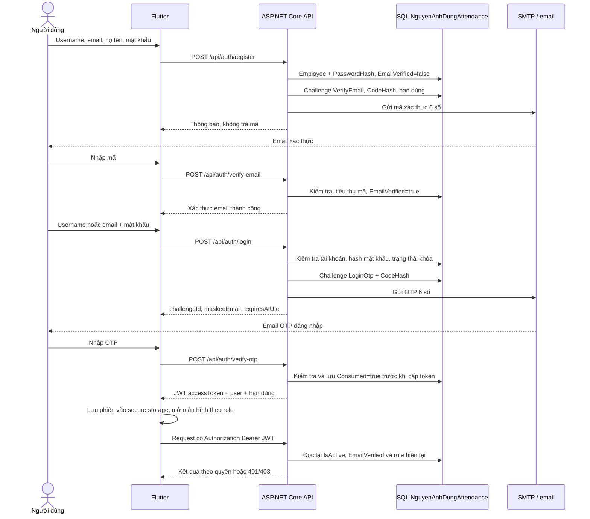
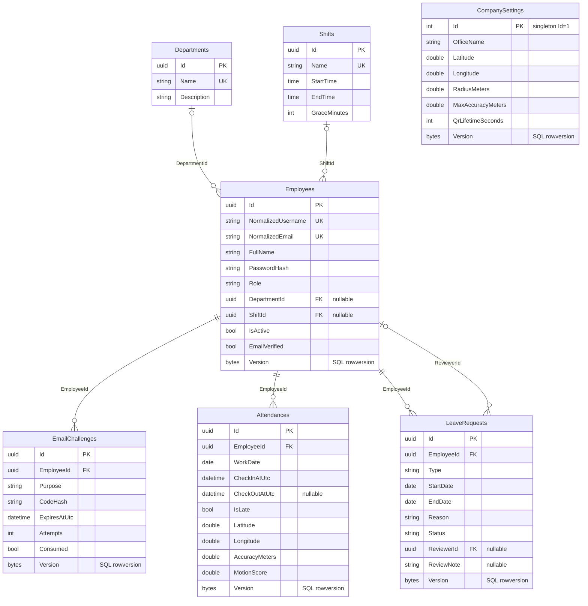
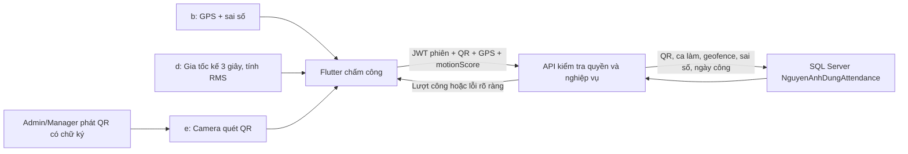
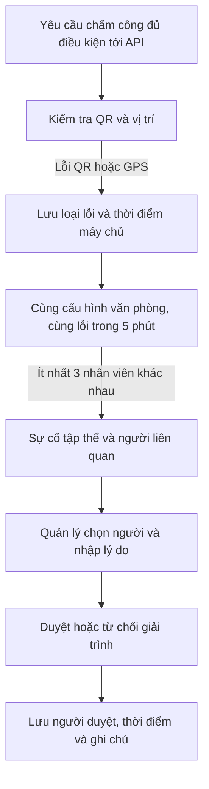

# Kiến trúc để thuyết trình — NguyenAnhDung Attendance

Nhóm **Hữu Duyên**, cá nhân **Nguyên Anh Dũng**. Flutter gọi ASP.NET Core Web API qua JSON; API xử lý quyền và nghiệp vụ rồi ghi **SQL Server database `NguyenAnhDungAttendance`**. SMTP gửi mã xác thực/OTP. Điện thoại không kết nối trực tiếp SQL Server hay giữ mật khẩu SMTP.

## Đăng ký email và đăng nhập hai bước

Mã có hạn 10 phút, tối đa 5 lần nhập; yêu cầu gửi lại có khoảng chờ. Database lưu hash mã, không lưu OTP dạng rõ. PasswordHasher băm mật khẩu; app không lưu password/OTP. JWT chỉ được cấp sau OTP hợp lệ; thay đổi vai trò hoặc vô hiệu hóa tài khoản có hiệu lực ở các request tiếp theo. Mã OTP/xác thực không được trả trong response JSON. Chế độ ghi mã vào console chỉ dành cho Development.

## Mô hình dữ liệu

Sơ đồ rút gọn theo [Entities.cs](../NguyenAnhDung.Attendance.Api/Models/Entities.cs) và [AttendanceDbContext.cs](../NguyenAnhDung.Attendance.Api/Data/AttendanceDbContext.cs). Tên thực tế là tên các `DbSet` bên dưới; trường không cần cho thuyết trình được lược bớt.

`DepartmentId`, `ShiftId` và `ReviewerId` là khóa ngoại tùy chọn. `CompanySettings` là bản ghi cấu hình chung, không có khóa ngoại giả nối vào từng lượt công. `Attendances` có unique index **(EmployeeId, WorkDate)** để chống chấm vào trùng trong ngày; bảng còn lưu tọa độ/sai số/chuyển động lúc chấm ra. Các trường thời điểm là UTC; `WorkDate` tính theo UTC+7. Không có ca qua đêm trong phạm vi hiện tại.

Xóa nhân viên là đổi `IsActive=false`, giữ lịch sử. Xóa phòng ban/ca bị chặn khi còn được gán. Rowversion kiểm soát cập nhật đồng thời; giao dịch bảo vệ Admin cuối cùng cần được nghiệm thu trên SQL Server thật. Đơn `Correction` chỉ lưu yêu cầu và quyết định duyệt, không tự tạo giờ công.

## Ba mục nâng cao b, d, e

| Mục của đề | Cách triển khai | Vì sao là mục riêng |
|---|---|---|
| **b — Chia sẻ vị trí** | Flutter lấy GPS và sai số; gửi khi xác nhận vào/ra. API tính khoảng cách tới công ty | Dữ liệu vị trí, sử dụng geolocation |
| **d — Đo chuyển động** | Đọc gia tốc không gồm trọng lực khoảng 3 giây, tính `sqrt(mean(x²+y²+z²))`, hiển thị và gửi `motionScore` | Đo cảm biến gia tốc thực, khác GPS và camera |
| **e — Nhận diện QR** | Camera đọc QR ngắn hạn do quản lý phát; API kiểm tra chữ ký, audience, purpose và thời hạn | Nhận diện mã qua camera; QR thuộc mục e |

QR chứa token **`purpose=attendance-qr`**, audience **`NguyenAnhDung.AttendanceQr`**, ký bằng khóa dẫn xuất riêng; JWT phiên dùng **`purpose=access`**, audience cấu hình cho Mobile. QR không thể thay JWT đăng nhập, và JWT phiên không được dùng như QR. Khi chấm vào cần cả JWT phiên và QR hợp lệ; chấm ra dùng JWT + vị trí + dữ liệu chuyển động.

Server kiểm tra tọa độ hữu hạn/đúng miền, độ chính xác GPS, bán kính, ca được gán, QR còn hạn và lượt vào duy nhất mỗi người/ngày. App chỉ gửi vị trí theo thao tác; không theo dõi nền. Gia tốc kế là phép đo được lưu, không bảo đảm chống GPS giả hoặc chấm công hộ. Vân tay và QR cùng thuộc e, không tính thêm một mục thứ tư.

## Sự cố chấm công tập thể

`AttendanceFailureAttempts` lưu lần thử bị lỗi, có thể chưa thuộc sự cố khi chưa đủ ba người. `AttendanceIncidents` lưu nhóm lỗi và khóa băm cấu hình văn phòng; `AttendanceIncidentParticipants` liên kết một nhân viên với một sự cố, giữ lần thử đầu/cuối, số lần thử và quyết định giải trình. Khóa duy nhất `(IncidentId, EmployeeId)` tránh trùng người trong nhóm. Không lưu token QR vào các bảng này.

Những lần thử đã gắn vào một sự cố không được dùng lại để tạo sự cố mới. Người đã có quyết định không được tự động bổ sung bằng chứng vào quyết định cũ. Xét duyệt một lô chạy trong giao dịch: nếu có người không thuộc nhóm, đã được xét duyệt hoặc là chính người duyệt, cả lô bị từ chối. Quyết định không ghi vào bảng `Attendances`, nên giờ công và `IsLate` giữ nguyên.

Nhật ký phản ánh yêu cầu đã tới máy chủ; không chứng minh hiện diện hay tự phát hiện yêu cầu bị mất hoàn toàn do mạng. Cơ chế gom nhóm được thiết kế cho một tiến trình API của đồ án; triển khai nhiều máy chủ cần cơ chế đồng bộ phân tán riêng. Xem [quy tắc và kịch bản demo](INCIDENTS.md).

## Ma trận quyền

| Hành động | Admin | Manager | Employee |
|---|---|---|---|
| Giao diện chính | Quản trị | Quản lý | Dashboard cá nhân |
| Đọc phòng ban/ca/cấu hình công ty | Có | Có | Có |
| CRUD phòng ban/ca, sửa cấu hình công ty | Có | Không | Không |
| Xem danh sách nhân viên | Có | Có | Không |
| Tạo/sửa/vô hiệu hóa nhân viên, gán role/ca | Có | Không | Không |
| Phát QR | Có | Có | Không |
| Chấm công bản thân | Khi được gán ca | Khi được gán ca | Khi được gán ca |
| Đọc lịch sử công/đơn | Tất cả | Tất cả | Chỉ của mình |
| Tạo đơn; sửa/xóa khi Pending | Đơn của mình | Đơn của mình | Đơn của mình |
| Duyệt/từ chối đơn | Đơn người khác | Đơn của Employee khác | Không |
| Xem sự cố chấm công tập thể | Tất cả | Tất cả | Chỉ sự cố có mình, chi tiết của mình |
| Xét duyệt giải trình sự cố | Người khác đang Pending | Người khác đang Pending | Không |

Quyền được thực thi tại API; ẩn nút giao diện chỉ giúp sử dụng dễ hơn. Đề tài không có nghiệp vụ khách hàng nên không tạo vai trò Customer. Danh sách kịch bản nghiệm thu và kết quả chạy hiện tại nằm trong [DEMO.md](DEMO.md).
